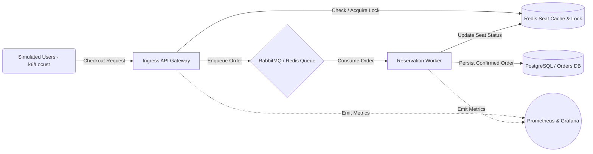

# Goal: High-Concurrency Dynamic Seat Reservation & Flash Sale Platform

---
### 1. Context and Problem Statement
Ticketing and event platforms face issues and problems such as system crashes from unexpected user traffic spikes. In high-demand concert tours and limited product drops, operating systems with direct synchronous database locks not just increases checkout latency and accelerates connection pool exhaustion but causes severe revenue loss when servers go offline. Overbooking and race conditions manifest as concurrent duplicate purchases and often go unnoticed until double-booking disputes occur.

This platform provides a real-time, end-to-end ingestion and order processing backend that:

- Collects live seat reservation requests like user session tokens, seat identifiers, and checkout intent via ingress gateways.

- Continuously tracks seat inventory states across their lifecycle using distributed locks and status flags.

- Runs dynamic queue processing in real-time to prevent overselling and protect the database before system failure.
---

### 2. Goal and Non-Goals

#### Goals
- **G1** Ingest high-frequency checkout requests from up to 50,000 concurrent simulated users.

- **G2** Provide sub-200ms latency for seat map lookups and reservation confirmation queues

- **G3** Maintain absolute consistency and zero double-booking per individual seat.

- **G4** Ensure that the worker and API infrastructure can auto-scale during peak flash sale windows.

#### Non-Goals

- **NG1** We will not build a full banking payment gateway or integrate physical card readers. (Payment processing will be simulated via a delayed mock worker for this HomeLab project.)


- **NG2** We will not build a full customer-facing mobile application frontend.

 - **NG2** We will not perform long-term recommendation machine learning model training in the hot path. Only atomic reservation locks and validation will run in the live stream.

 ### 3. Non-Functional Requirement

If we have 50000 concurrent users attempting to reserve seats in a 10000-seat venue, we receive rapid bursts of checkout actions within the first 60 seconds of a sale opening. We monitor system throughput continuously under load. We considered processing every checkout with direct database transactions, but since synchronous row locks cause connection exhaustion and timeouts, it is necessary to buffer writes through an in-memory queue.

The maximum accepted latency from the checkout click to the "Reservation Queued" response should be 200 ms. In case of high concurrency, this ensures real-time feedback to users, prevents duplicate button presses, and allows the backend to shed peak loads smoothly.

When it comes to payload size, we should aim to minimize it to minimize network load. A typical JSON payload would look something like this:

```json
{
  "user_id": "USR-9482",
  "event_id": "EVT-8839-4401",
  "section": "A",
  "row": "12",
  "seat_number": 4,
  "timestamp": 1791897600,
  "price_cents": 12500
}
```

Finally, we have to talk about data loss tolerance. If something happens on the server side, like a crash or a reboot, we need to ensure message persistence in our queue so pending reservations are not dropped and the database maintains a consistent state.

### 4 Service Connections



    
 ### 5 Technologies

  #### Choosing the Queue Broker
  **Decision** We will use RabbitMQ as the primary ingestion queue.

  **Reason** To meet the sub-200ms latency target while handling thousands of concurrent checkout requests without locking the relational database.

  #### Choosing the database
  **Decision** We will use Redis for in-memory seat locks alongside PostgreSQL for persistent order records.

  **Reason** Seat availability queries require sub millisecond in-memory lookups, while PostgreSQL ensures strict ACID transactional safety for completed financial purchases.
 